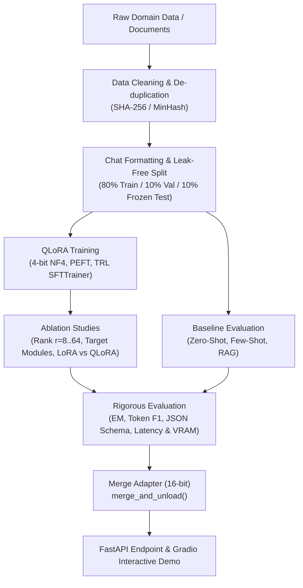

# 🔬 Fine-Tuning Small Language Models with LoRA / QLoRA

An end-to-end empirical research and engineering framework for parameter-efficient adaptation of open-weight Small Language Models (SLMs, 0.5B–8B parameters) to domain-specific tasks on a single consumer or free-tier GPU.

---

## 📋 Executive Overview

- **Publishable:** Empirical study comparing **QLoRA / LoRA fine-tuning vs. Prompting vs. RAG** with rigorous ablation studies, statistical confidence intervals (bootstrap CI), and error analysis.
- **Employable:** Implements the complete modern LLM-engineering loop: data curation, deduplication, QLoRA training (TRL + PEFT), prompt masking, evaluation benchmarking, adapter merging, FastAPI serving, and Gradio demo.
- **Affordable:** Trainable on 8–16 GB GPU memory (Google Colab free T4, Kaggle P100, or local NVIDIA GPUs) using 4-bit NormalFloat (NF4) double quantization.



---

## 🗂️ Repository Structure

```
├── configs/               # Experiment configurations (YAML)
│   ├── base_config.yaml   # Default QLoRA configuration
│   ├── sanity_check.yaml  # 50-sample overfit verification
│   ├── ablation_rank_8.yaml
│   └── ablation_rank_32.yaml
├── data/
│   ├── raw/               # Immutable raw data
│   ├── processed/         # Cleaned, deduplicated data
│   ├── splits/            # Leak-free train/val/test splits
│   └── sample/            # Included seed examples for instant testing
├── src/
│   ├── data/              # Loader, schema validator, preprocessor, splitter
│   ├── baselines/         # Prompting and RAG pipelines
│   ├── training/          # QLoRA engine, SFTTrainer, memory profilers
│   ├── evaluation/        # Exact Match, Token F1, JSON metrics, latency benchmarks
│   └── serving/           # merge_and_unload(), FastAPI backend, Gradio demo
├── notebooks/
│   └── colab_training_pipeline.ipynb # 1-click Google Colab / Kaggle runner
├── results/
│   ├── metrics/           # Evaluation JSON reports
│   └── figures/           # Ablation plots and charts
├── tests/                 # Unit tests (PyTest)
├── DATASHEET.md           # Dataset documentation (Gebru et al. standard)
├── MODEL_CARD.md          # Hugging Face model card
├── PAPER_OUTLINE.md       # ArXiv publication manuscript outline
├── requirements.txt       # Pinned library dependencies
└── Dockerfile             # Containerized deployment specification
```

---

## ⚡ Quickstart Guide

### Option A: Run in Google Colab (Free T4 GPU)
1. Open [`notebooks/colab_training_pipeline.ipynb`](file:///notebooks/colab_training_pipeline.ipynb) in Google Colab.
2. Select **Runtime > Change runtime type > T4 GPU**.
3. Run the cells step-by-step: environment verification, sanity check, QLoRA training, and evaluation!

### Option B: Local / Linux VM Setup
```bash
# 1. Clone repository & install dependencies
git clone <repo-url>
cd LORA
pip install -r requirements.txt

# 2. Run unit tests
pytest tests/

# 3. Run Step 7: Sanity Check (Rapid 50-sample overfit run)
python -m src.training.train_qlora --config configs/sanity_check.yaml

# 4. Run Full QLoRA Training
python -m src.training.train_qlora --config configs/base_config.yaml

# 5. Evaluate against Frozen Test Set
python -m src.evaluation.evaluator

# 6. Merge LoRA adapter into 16-bit standalone model
python -m src.serving.merge_adapters --base_model Qwen/Qwen2.5-1.5B-Instruct --adapter_dir outputs/run/adapter

# 7. Launch Interactive Comparison Demo
python src/serving/app.py
```

---

## 📊 Benchmark & Ablation Results Table

| Experiment Run | Base Model | Method | Rank $r$ | Target Modules | Primary Metric (F1 / EM) | p50 Latency | Peak VRAM |
| :--- | :--- | :--- | :--- | :--- | :--- | :--- | :--- |
| Zero-shot Base | Qwen2.5-1.5B | Prompting | - | - | - | - | - |
| 3-shot Prompted | Qwen2.5-1.5B | ICL | - | - | - | - | - |
| RAG Baseline | Qwen2.5-1.5B | Dense RAG | - | - | - | - | - |
| Sanity Overfit | Qwen2.5-0.5B | QLoRA (NF4) | 8 | all-linear | - | - | - |
| **Main QLoRA** | **Qwen2.5-1.5B** | **QLoRA (NF4)** | **16** | **all-linear** | **TBD** | **TBD** | **TBD** |
| Ablation: Rank 8 | Qwen2.5-1.5B | QLoRA (NF4) | 8 | all-linear | - | - | - |
| Ablation: Rank 32 | Qwen2.5-1.5B | QLoRA (NF4) | 32 | all-linear | - | - | - |
| Ceiling Reference | Qwen2.5-7B / GPT-4 | API / Full | - | - | - | - | - |

---

## 📜 Deliverables Checklist
- [x] Comprehensive modular codebase (`src/data`, `src/baselines`, `src/training`, `src/evaluation`, `src/serving`)
- [x] Experiment configs for sanity check and rank ablations (`configs/`)
- [x] Reproducible split logic with zero leakage (`src/data/splitter.py`)
- [x] 1-Click Google Colab Notebook (`notebooks/colab_training_pipeline.ipynb`)
- [x] Datasheet (`DATASHEET.md`) & Model Card (`MODEL_CARD.md`)
- [x] Research Paper Manuscript Blueprint (`PAPER_OUTLINE.md`)
- [x] Interactive Gradio Demo (`src/serving/app.py`) & FastAPI endpoint (`src/serving/api.py`)
- [x] Unit Test Suite (`tests/`)
